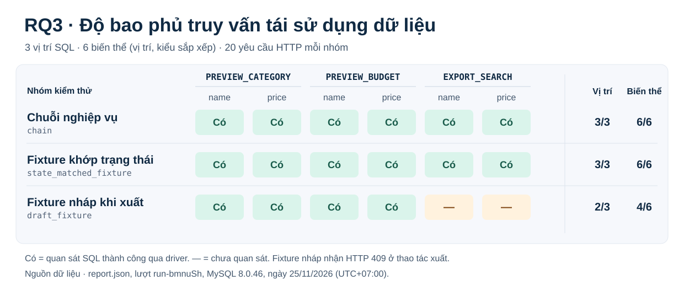

# RQ3 · So sánh độ bao phủ

## Câu hỏi và câu trả lời

> Trên cùng tập chức năng, với dữ liệu hợp lệ và cùng tiêu chí quan sát truy vấn, độ bao phủ các vị trí tạo SQL sử dụng dữ liệu đã lưu khác nhau thế nào giữa kiểm thử từng yêu cầu có fixture hợp lệ và kiểm thử theo chuỗi ghi–đọc lại–tái sử dụng? Điều kiện trạng thái hoặc nhánh nghiệp vụ nào giải thích từng chênh lệch?

**Hoàn tất.** Trên 60 yêu cầu HTTP mới, chuỗi và fixture khớp trạng thái cùng bao phủ **3/3 vị trí và 6/6 biến thể (100%)**. Fixture nháp bao phủ **2/3 vị trí và 4/6 biến thể (66,7%)**. Cả bốn yêu cầu xuất của nhóm nháp đọc được bản ghi nhưng nhận HTTP 409 vì trạng thái là `draft`. Hai nhánh xem trước đạt cùng độ bao phủ ở cả ba nhóm vì mỗi nhóm đều có ca với `ceiling = null` và ca với `ceiling = 250000`, mỗi nhánh dùng cả hai kiểu sắp xếp. [Bảng bằng chứng](bang-chung.csv)

## Thiết kế và môi trường

- Mỗi nhóm gửi 20 yêu cầu, gồm năm thao tác `save`, `load`, `preview`, `publish`, `export` trên bốn ca giao giữa `sort ∈ {name, price}` và `ceiling ∈ {null, 250000}` đồng. Ba nhóm dùng cùng hàm xử lý HTTP, danh mục tổng hợp, bộ lọc và tiêu chí quan sát. Trong `chain`, năm thao tác của từng ca dùng chung một `searchId`. Trong hai nhóm fixture, mỗi yêu cầu có ID riêng. Fixture của yêu cầu xuất có trạng thái `published` trong `state_matched_fixture` và `draft` trong `draft_fixture`. Cách chuẩn bị các thao tác còn lại giống nhau giữa hai nhóm fixture. [Kế hoạch trước lượt chạy](ke-hoach.md) · [Bộ chạy](../../../../src/study.js)
- Mẫu số lấy từ danh mục mã, gồm ba `site` có tham số hoặc bộ chọn dùng dữ liệu đã lưu. Mỗi vị trí có hai biến thể sắp xếp. Một vị trí hay biến thể được tính khi có ít nhất một sự kiện `type = sql` do bộ quan sát ghi sau khi driver trả kết quả thành công, kể cả kết quả rỗng. Các lệnh chuẩn bị fixture trực tiếp, khởi tạo, thiết lập kết nối và dọn dữ liệu nằm ngoài phép đo. [Danh mục và điểm quan sát](../../../../src/statements.js)
- Mã đợt `20261125-211408-bao-phu`, SHA `608361d0708a2bdf2ec1a0f7c170bf97ded69a3b`. `git status --short` rỗng khi bắt đầu. Dùng nguyên mã ứng dụng và bộ chạy. Lượt chính duy nhất `run-bmnuSh` ghi kết quả lúc **21:17:25.642 ngày 25/11/2026 (UTC+07:00)**, tương ứng `2026-11-25T14:17:25.642Z`. Node.js `v24.21.0`, npm `11.19.0`, MySQL Community Server `8.0.46`, mysql2 `3.24.6`. [Dữ liệu gốc JSON](du-lieu-goc/run-bmnuSh/report.json) · [Bản tổng hợp CLI](du-lieu-goc/run-bmnuSh/report.md)
- HTTP chạy trên `127.0.0.1` với cổng động. Dùng một phiên MySQL riêng tại `127.0.0.1:57387`, schema `sqli_study_rq3`, kết nối `utf8mb4`, `multipleStatements: false` và autocommit bật. Phiên chạy nhận cấu hình MySQL qua biến môi trường và khởi tạo bốn sản phẩm mẫu. Truy vấn hậu kiểm ghi nhận bốn sản phẩm và 0 bản ghi bộ lọc. [Kết nối ứng dụng](../../../../src/database.js) · [Nhật ký phiên](nhat-ky/phien-chay.txt)

| Lệnh từ `thuc-nghiem/` | Mã thoát | Kết quả |
| --- | ---: | --- |
| `npm.cmd test` | 0 | 4/4 kiểm thử đạt. [Nhật ký](nhat-ky/npm-test.txt) |
| `npm.cmd run init` | 0 | Khởi tạo bảng và danh mục mẫu. [Nhật ký](nhat-ky/npm-init.txt) |
| `npm.cmd run study -- --out nghien-cuu/ket-qua/RQ3/20261125-211408-bao-phu/du-lieu-goc` | 0 | 60 yêu cầu. Bộ chạy kiểm tra mã HTTP, dữ liệu đọc lại, ID và thứ tự sản phẩm, cùng đường đi SQL. [Nhật ký](nhat-ky/npm-study.txt) |

## Kết quả và bằng chứng

Mỗi vị trí quan sát được trong bảng có cả hai biến thể `name` và `price`.

| Nhóm | Yêu cầu | Vị trí | Biến thể | Vị trí và biến thể quan sát được | Vị trí và biến thể chưa quan sát |
| --- | ---: | ---: | ---: | --- | --- |
| `chain` | 20 | 3/3 (100%) | 6/6 (100%) | `PREVIEW_CATEGORY`, `PREVIEW_BUDGET`, `EXPORT_SEARCH` · `name` và `price` tại mỗi vị trí | ∅ |
| `state_matched_fixture` | 20 | 3/3 (100%) | 6/6 (100%) | `PREVIEW_CATEGORY`, `PREVIEW_BUDGET`, `EXPORT_SEARCH` · `name` và `price` tại mỗi vị trí | ∅ |
| `draft_fixture` | 20 | 2/3 (66,7%) | 4/6 (66,7%) | `PREVIEW_CATEGORY`, `PREVIEW_BUDGET` · `name` và `price` tại mỗi vị trí | `EXPORT_SEARCH` · `EXPORT_SEARCH/name`, `EXPORT_SEARCH/price` |

Chiều chênh lệch là nhóm A trừ nhóm B. Điểm phần trăm tính từ phân số trước khi làm tròn.

| A → B | Δ vị trí | Δ biến thể | Hiệu vị trí A∖B / B∖A | Hiệu biến thể A∖B / B∖A | Điều kiện giải thích |
| --- | ---: | ---: | --- | --- | --- |
| `chain` → `state_matched_fixture` | 0 (0,0 điểm %) | 0 (0,0 điểm %) | ∅ / ∅ | ∅ / ∅ | Cùng phủ hai nhánh xem trước và cùng đọc `published` khi xuất. |
| `state_matched_fixture` → `draft_fixture` | +1 (+33,3 điểm %) | +2 (+33,3 điểm %) | `EXPORT_SEARCH` / ∅ | `EXPORT_SEARCH/name`, `EXPORT_SEARCH/price` / ∅ | Fixture của yêu cầu xuất đọc `published` ở A và `draft` ở B. |
| `chain` → `draft_fixture` | +1 (+33,3 điểm %) | +2 (+33,3 điểm %) | `EXPORT_SEARCH` / ∅ | `EXPORT_SEARCH/name`, `EXPORT_SEARCH/price` / ∅ | Chuỗi xuất sau công bố trên cùng ID. Fixture nháp công bố và xuất trên hai ID riêng. |

**Xem trước.** Cả 12 yêu cầu xem trước trả HTTP 200. Dấu vết có `[0] LOAD_SEARCH/fixed`, `[1] preview_ceiling`, rồi `[2]` là vị trí và biến thể trong bảng. Mã bằng chứng ghép ba nhóm trên cùng ca. [Bảng bằng chứng](bang-chung.csv) · [Trình xử lý](../../../../src/app.js)

| Ca | `hasCeiling` | SQL tại `trace[2]` trong cả ba nhóm | Mã bằng chứng |
| --- | --- | --- | --- |
| `name-unlimited` | `false` | `PREVIEW_CATEGORY/name` | `RQ3-PREVIEW-name-unlimited` |
| `price-unlimited` | `false` | `PREVIEW_CATEGORY/price` | `RQ3-PREVIEW-price-unlimited` |
| `name-budget` | `true` | `PREVIEW_BUDGET/name` | `RQ3-PREVIEW-name-budget` |
| `price-budget` | `true` | `PREVIEW_BUDGET/price` | `RQ3-PREVIEW-price-budget` |

**Xuất.** Trong `chain` và `state_matched_fixture`, cả bốn ca trả HTTP 200. Theo thứ tự, dấu vết có `[0] LOAD_SEARCH/fixed`, `[1] export_requires_published` với `state = published` và `allowed = true`, rồi `[2] EXPORT_SEARCH/name` hoặc `[2] EXPORT_SEARCH/price` theo ca. Trong `draft_fixture`, cả bốn ca trả HTTP 409 với `[0] LOAD_SEARCH/fixed` và `[1] export_requires_published` ghi `state = draft`, `allowed = false`. Ở cả ba nhóm, trạng thái đọc qua sự kiện tại `trace[1]` khớp `startingState`. [Bảng bằng chứng](bang-chung.csv) · [Trình xử lý](../../../../src/app.js)

| Ca xuất | `requestId` của `chain` (200) | `requestId` của `state_matched_fixture` (200) | `requestId` của `draft_fixture` (409) |
| --- | --- | --- | --- |
| `name-unlimited` | `6842fcb7-3e88-4b54-a294-8f81f99485fb` | `ea87619c-d794-4cb8-954c-fe13649ddfb1` | `1eccddc0-6ec3-436e-91a9-312089f3c45b` |
| `price-unlimited` | `174e7fca-85a2-484d-8bbb-4ef42e278218` | `fb7c2948-36e6-4d7b-bcf4-db44d9cc4e06` | `3da5c0dc-bc56-4a8f-8d0a-c356b10ed3db` |
| `name-budget` | `a52f30b0-4bb9-4964-8586-b19c1a41b406` | `8bfe3108-7a79-4218-be18-91ca0f95e394` | `46340f98-bb7b-42cc-a0ae-edabd2e9894a` |
| `price-budget` | `3b54099b-5c84-4ac0-ad19-2506e211f1fd` | `fb99b472-0cfd-4502-ac9d-4b47ee56f5a6` | `dba9e2ba-56a6-4fb6-8101-e2d96cd68ff6` |

Ví dụ ở ca `name-budget`, yêu cầu công bố của `chain` (`d4388948-7d72-4846-90b1-153e32b5fcae`) trả HTTP 200 và `PUBLISH_SEARCH` cập nhật một dòng. Yêu cầu xuất dùng cùng `searchId` `1863d447-d310-4a9f-a203-927bddec53bd` và đọc được trạng thái `published`. Trong `draft_fixture`, công bố cũng cập nhật một dòng nhưng dùng `searchId` `4d01e2ae-6fe4-47d0-b15e-4d6292ddb261`, còn xuất dùng ID `3f437d16-33d2-4255-8b3b-4b2e799880f1` và đọc `draft`. Mã `RQ3-PUBLISH-name-budget` và `RQ3-EXPORT-name-budget` ghi các sự kiện liên quan. [Bảng bằng chứng](bang-chung.csv) · [Dữ liệu gốc](du-lieu-goc/run-bmnuSh/report.json)

## Kiểm chứng và sai lệch

Tệp kiểm chứng lọc `runs[].requests[].trace[]` theo `type = sql` và tập `reuseSites`, gộp theo `site` hoặc cặp `(site, variant)` trong từng nhóm, rồi tính cả hai chiều hiệu tập hợp cho ba cặp so sánh. Kết quả khớp `rq3.denominator`, `rq3.suites` và các hàng độ bao phủ trong báo cáo CLI. `rq3.differences` của CLI chỉ tóm tắt cặp chuỗi và fixture nháp. Phép tính lại cung cấp thêm hai cặp trong bảng chênh lệch. [Mã kiểm chứng](kiem-chung.mjs) · [Kết quả kiểm chứng](nhat-ky/kiem-chung.txt)

```powershell
node nghien-cuu/ket-qua/RQ3/20261125-211408-bao-phu/kiem-chung.mjs nghien-cuu/ket-qua/RQ3/20261125-211408-bao-phu/du-lieu-goc/run-bmnuSh/report.json
```

Có đủ 60 `requestId` phân biệt và 44 `searchId` phân biệt (4 trong chuỗi và 20 trong mỗi nhóm fixture). Chuỗi và fixture khớp trạng thái đều có 4 phản hồi 201 và 16 phản hồi 200. Fixture nháp có 4 phản hồi 201, 12 phản hồi 200 và 4 phản hồi 409. Mã kiểm chứng xác nhận các bộ ca, thứ tự sự kiện của từng yêu cầu, trạng thái, biến thể và ID sản phẩm có trong JSON. [Kết quả kiểm chứng](nhat-ky/kiem-chung.txt)

CSV lưu 104 dòng sự kiện. `source_ref` trỏ tới tệp gốc và đường dẫn JSON Pointer. `event_index` bắt đầu từ 0. `starting_state` rỗng ở bước lưu vì bộ lọc chưa tồn tại. Trường quyết định rỗng ở dòng SQL và `variant` rỗng ở dòng quyết định. Dòng quyết định xem trước ghi vị trí được chọn. Dòng quyết định xuất có `site` rỗng vì sự kiện này chỉ ghi điều kiện trạng thái. Với yêu cầu xuất bị chặn, dùng cùng lúc dòng quyết định `trace[1]` và dòng SQL cuối `trace[0]` có `LOAD_SEARCH` để xác nhận trình xử lý đã đọc bản ghi rồi dừng. [Bảng bằng chứng](bang-chung.csv)

Bước dọn phiên MySQL ban đầu trả mã 1 sau khi báo cáo đã được ghi và truy vấn hậu kiểm đã thành công. Sau khi trình khởi chạy dừng, tiến trình máy chủ con vẫn giữ tệp redo. Lượt dọn bổ sung đối chiếu tiến trình với nhật ký khởi động và cổng loopback, dừng máy chủ, xác nhận cổng đã đóng và xóa thư mục dữ liệu tạm. Số liệu sử dụng duy nhất lượt tích hợp mới `run-bmnuSh`. [Nhật ký phiên](nhat-ky/phien-chay.txt)

## Diễn giải và giới hạn

`preview_ceiling` chọn vị trí theo việc trần giá có giá trị hay không, còn `sort` chọn biến thể trong vị trí. Bộ ca cho mỗi nhóm phủ cả bốn tổ hợp đó. Chênh lệch tập trung ở xuất, nơi điều kiện `state = published` quyết định có gọi `EXPORT_SEARCH` hay không. Đối chiếu hai nhóm fixture giữ yêu cầu độc lập và thay trạng thái của bản ghi xuất, qua đó cô lập được điều kiện này trong bộ ca. Chuỗi kiểm tra thêm việc trạng thái do thao tác công bố tạo ra có được yêu cầu xuất đọc lại trên cùng ID. [Trình xử lý](../../../../src/app.js) · [Bộ chạy](../../../../src/study.js)

Phép đo mô tả một lượt, trên bốn bộ lọc tổng hợp và ba vị trí của ứng dụng. Điểm quan sát là kết quả thành công tại driver. Tập ca hoặc tiền điều kiện khác cần phép đo riêng để xác định mức bao phủ. Cùng độ bao phủ truy vấn cho biết hai nhóm quan sát cùng tập vị trí và biến thể trong phạm vi đã đo.

## Hình và đoạn trích cho tiểu luận



*Hình RQ3. Mỗi ô cho biết một biến thể SQL có được quan sát thành công qua driver trong 20 yêu cầu của nhóm hay không. Mẫu số là ba vị trí và sáu biến thể. Nhóm fixture nháp dùng bản ghi `draft` cho yêu cầu xuất để đo tác động của tiền điều kiện `published`. Nguồn là dấu vết của lượt `run-bmnuSh`.* [Hình SVG](hinh/rq3-ma-tran-bao-phu.svg) · [Dữ liệu nguồn](du-lieu-goc/run-bmnuSh/report.json)

> Trong ứng dụng nghiên cứu chạy trên MySQL 8.0.46, kiểm thử theo chuỗi và kiểm thử từng yêu cầu với fixture khớp tiền điều kiện đều bao phủ 3/3 vị trí và 6/6 biến thể truy vấn tái sử dụng dữ liệu. Fixture nháp bao phủ 2/3 vị trí và 4/6 biến thể do bốn yêu cầu xuất đọc trạng thái `draft` và nhận HTTP 409. Cả ba nhóm đạt cùng độ bao phủ xem trước vì cùng thử hai cấu hình trần giá và hai kiểu sắp xếp. Kết quả mô tả một lượt chạy gồm 20 yêu cầu mỗi nhóm, với độ bao phủ quan sát tại driver trên tập truy vấn của ứng dụng.

## Kiểm tra trước khi bàn giao

- [x] Hai vế của RQ có câu trả lời và liên kết đến bằng chứng.
- [x] Số liệu và tập vị trí, biến thể đã được tính lại và đối chiếu với báo cáo CLI, bảng và hình.
- [x] Hồ sơ có liên kết tương đối và lệnh kiểm chứng.
- [x] Hình đã được kết xuất thử và kiểm tra chữ, nhãn và chú giải.
